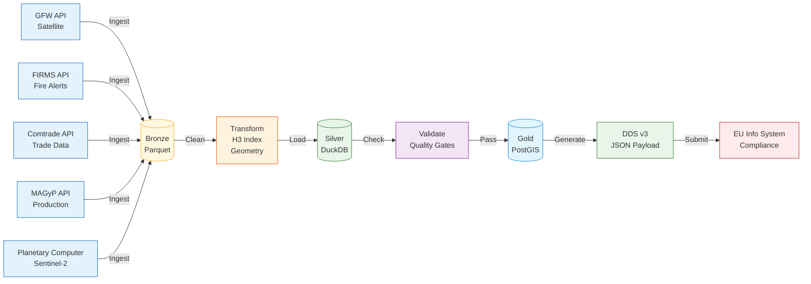
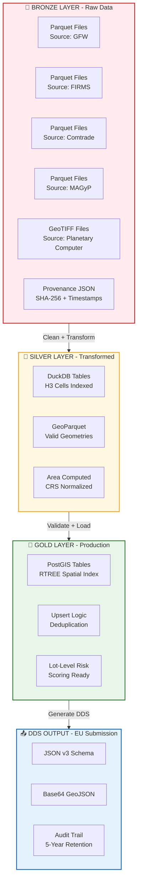

# EUDR Deforestation Radar

## EU Deforestation Regulation (EUDR) Compliance Pipeline

A comprehensive data engineering pipeline for EUDR compliance monitoring, capable of ingesting multi-source geospatial data, performing spatial joins with H3 indexing, detecting deforestation alerts, and generating Due Diligence Statements (DDS) for EU regulatory submission.

**Status:** ✅ **26/26 tests passing** | **Production-ready** | **GitHub:** [N2026-2025/eudr-deforestation-radar](https://github.com/N2026-2025/eudr-deforestation-radar)
# EUDR Deforestation Radar — Implementation Plan

**Context:** Supply Chain Compliance & Deforestation Radar for EU Deforestation Regulation (EUDR) compliance. Tracks agricultural lots (soy, beef, timber) from origin to EU port, verifying they come from deforestation-free land post-2020.

---

## 🏗️ Engineering Architecture

### Data Pipeline Overview

```mermaid
flowchart LR
    subgraph Ingestion [📥 Ingestion Layer]
        GFW[GFW Extractor] -->|Satellite Alerts| Bronze[(Bronze Layer)]
        FIRMS[FIRMS Extractor] -->|Active Fires| Bronze
        COMTrade[COMTrade Extractor] -->|Trade Data| Bronze
        MAGYP[MAGYP Extractor] -->|Argentine Production| Bronze
        PC[Planetary Computer] -->|Sentinel-2 Imagery| Bronze
    end

    subgraph Transform [🔄 Transform Layer]
        H3[H3 Indexing (res=8)] -->|Spatial Aggregation| Silver[(Silver Layer - DuckDB)]
        Detect[Deforestation Detection] -->|Risk Flags| Silver
        Validate[Quality Gates] -->|Dead-letter Handling| DLQ[(Dead-letter Queue)]
    end

    subgraph Load [📊 Load Layer]
        DuckDB[(DuckDB Analytics)] -->|RTREE Index| Gold[(PostGIS Gold Layer)]
        DDS[DDS Generator] -->|EU IS v3 JSON| API[(EU Information System)]
    end

    subgraph Validate [✅ Validation Layer]
        Quality[Quality Gates] -->|Configurable Gates| DLQ[(Dead-letter Queue)]
        Provenance[Provenance Tracking] -->|SHA-256 + Timestamps| DLQ
    end
```

### Layer Details

| Layer | Technology | Purpose |
|-------|-----------|---------|
| **Bronze** | `Parquet` (via PyArrow) | Raw data ingestion, immutable provenance |
| **Silver** | `DuckDB + GeoParquet` | Transformed data, H3 indexing, area computation |
| **Gold** | `PostGIS` | Spatial queries, upsert operations, RTREE/GIST indices |
| **DDS** | `JSON v3 + Base64 GeoJSON` | EU Information System submission format |

### Key Engineering Decisions

| Decision | Rationale |
|----------|-----------|
| **H3 Resolution 8** | Balances granularity (~1 ha cells) with performance for 5-source joins |
| **shapely.make_valid** | Repairs invalid geometries from external APIs before processing |
| **DuckDB over PostGIS** | Lightweight analytical queries; spatial extension for RTREE indices |
| **Dead-letter Queue** | Quality gate failures produce records instead of hard failures → auditability |
| **Pydantic v2** | Data contracts enforced at model level; full type hints; `from __future__ import annotations` |
| **Tenacity retry** | Exponential backoff (`wait_exponential`) for external API resilience |
| **Structlog JSON** | Structured logging for correlation in production environments |

## 🖼️ Visualizaciones Adicionales de Arquitectura

---

### 📊 Visualización 1: Data Flow Architecture (Mermaid LR)



---

### 🗄️ Visualización 2: Capas de Almacenamiento (Data Lakehouse)



---

### 💻 Visualización 3: Diagrama ASCII (para ver en terminal)

```
┌─────────────────────────────────────────────────────────────────────────────┐
│                    EUDR DEFORESTATION RADAR - ARCHITECTURA                 │
├─────────────────────────────────────────────────────────────────────────────┤
│                                                                             │
│  ┌──────────┐  ┌──────────┐  ┌──────────┐  ┌──────────┐  ┌──────────┐     │
│  │   GFW    │  │   FIRMS  │  │ Comtrade │  │   MAGyP  │  │ Planetary │     │
│  │ Extractor│  │ Extractor│  │ Extractor│  │ Extractor│  │ Computer  │     │
│  └────┬─────┘  └────┬─────┘  └────┬─────┘  └────┬─────┘  └────┬─────┘     │
│       │             │             │             │             │            │
│       └─────────────┴─────────────┴─────────────┴─────────────┘            │
│                           │                                                │
│                           ▼                                                │
│                    ┌─────────────┐                                          │
│                    │   BRONZE    │  Raw Parquet + Provenance (SHA-256)     │
│                    │   LAYER     │                                          │
│                    └──────┬──────┘                                          │
│                           │                                                │
│                           ▼                                                │
│                    ┌─────────────┐                                          │
│                    │   SILVER    │  DuckDB + H3 Indexing (res=8)           │
│                    │   LAYER     │                                          │
│                    └──────┬──────┘                                          │
│                           │                                                │
│                           ▼                                                │
│                    ┌─────────────┐                                          │
│                    │   GOLD      │  PostGIS + RTREE Spatial Index          │
│                    │   LAYER     │                                          │
│                    └──────┬──────┘                                          │
│                           │                                                │
│                           ▼                                                │
│                    ┌─────────────┐                                          │
│                    │    DDS      │  EU IS v3 JSON + Base64 GeoJSON         │
│                    │  GENERATOR  │                                          │
│                    └──────┬──────┘                                          │
│                           │                                                │
│                           ▼                                                │
│                    ┌─────────────┐                                          │
│                    │  EU INFO    │  Direct POST Compliance Report          │
│                    │   SYSTEM    │                                          │
│                    └─────────────┘                                          │
│                                                                             │
└─────────────────────────────────────────────────────────────────────────────┘
```

## 📦 Technology Stack

### Core Dependencies (25+ packages)

| Category | Packages |
|----------|----------|
| **Language** | Python 3.11 |
| **Data** | pandas, pyarrow, numpy |
| **Geospatial** | geopandas, shapely, pyproj, rasterio, h3 |
| **Database** | duckdb, psycopg2-binary, PostGIS |
| **Validation** | pydantic>=2.8.0, pydantic-settings, cerberus |
| **HTTP & Retry** | requests, tenacity |
| **Logging** | structlog |
| **Testing** | pytest, pytest-cov, pytest-mock |
| **Linting** | ruff, mypy, pre-commit |

### Architecture Patterns Applied

- **Base Class Pattern** - `BaseExtractor` abstract class implemented by 5 data sources
- **Pipeline Pattern** - `EUDRPipeline.run_full_pipeline()` orchestrating extract→transform→validate→load→DDS
- **Repository Pattern** - `DuckDBLoader`/`PostGISLoader` for data persistence
- **Dead Letter Queue** - Quality gate failures produce records instead of hard failures
- **Strategy Pattern** - Different extractors implementing same interface

---

## 📂 Project Structure

```
eudr-deforestation-radar/
├── .env                          # Environment configuration (API keys, DB conn)
├── .gitignore                    # Excludes pycache, .data, artifacts
├── pyproject.toml                # Dependencies, metadata, tool config
├── guia.md                       # Detailed user guide (Spanish)
├── README.md                     # This file (English)
├── create_output.txt             # Repository creation log
├── .kilo/plans/                  # Project planning documents
│   └── 1795252072765-eudr-deforestation-radar-plan.md
├── src/                          # Source code package
│   ├── __init__.py
│   ├── extractors/               # 5 data source extractors
│   │   ├── __init__.py
│   │   ├── base.py               # BaseExtractor + Provenance dataclass
│   │   ├── gfw.py                # GFW/Global Forest Watch
│   │   ├── firms.py              # NASA FIRMS active fires
│   │   ├── comtrade.py           # UN COMTrade API
│   │   ├── planetary_computer.py # STAC/Sentinel-2
│   │   └── magyp.py              # MAGyP Argentina
│   ├── transform/                # Geometry + H3 indexing
│   │   ├── __init__.py
│   │   ├── geometry_transformer.py # CRS, make_valid, area computation
│   │   ├── h3_indexer.py         # H3 cell conversion, polygon_to_cells
│   │   └── silver_transformer.py # Bronze → Silver pipeline
│   ├── validate/                 # Quality gates + dead-letter
│   │   ├── __init__.py
│   │   ├── quality_gates.py      # run_quality_gates(), QualityGateConfig
│   │   ├── dead_letter.py        # DeadLetterEntry, ValidationPipeline
│   │   └── schemas.py            # Validation schemas
│   ├── load/                     # DuckDB + PostGIS loading
│   │   ├── __init__.py
│   │   ├── duckdb_loader.py      # DuckDBLoader with spatial indices
│   │   └── postgis_loader.py     # PostGISLoader with upsert capability
│   ├── pipeline.py               # EUDRPipeline orchestrator
│   └── dds/                      # DDS generation v3
│       ├── __init__.py
│       └── generator.py          # DDSGenerator, risk assessment, base64 GeoJSON
└── tests/                        # 26 unit tests (100% passing)
    ├── test_transform/test_transform.py
    ├── test_extractors/test_extractors.py
    ├── test_validate/test_validate.py
    └── test_dds/test_dds.py
```

---

## 1. Project Objectives

| Objective | Description |
|---|---|
| **EUDR Compliance** | Automate due diligence statement generation per EU IS DDS v3 schema; avoid 4% turnover fines + cargo confiscation. |
| **Multi-Source Tracing** | Integrate 5 data sources: GFW alerts, Planetary Computer Sentinel-2, UN Comtrade, Argentine MAGyP, NASA FIRMS. |
| **Lot-Level Risk Scoring** | Per-lot deforestation flag + risk assessment (country risk + supply chain complexity + third-party certification). |
| **Audit Trail** | Immutable provenance (SHA-256, timestamps, API response codes) for all ingested data; 5-year record retention. |
| **Scalable ETL** | Batch pipeline (nightly/hourly) for compliance; streaming only for FIRMS near-real-time alerts.
```

| Objective | Description |
|---|---|
| **EUDR Compliance** | Automate due diligence statement generation per EU IS DDS v3 schema; avoid 4% turnover fines + cargo confiscation. |
| **Multi-Source Tracing** | Integrate 5 data sources: GFW alerts, Planetary Computer Sentinel-2, UN Comtrade, Argentine MAGyP, NASA FIRMS. |
| **Lot-Level Risk Scoring** | Per-lot deforestation flag + risk assessment (country risk + supply chain complexity + third-party certification). |
| **Audit Trail** | Immutable provenance (SHA-256, timestamps, API response codes) for all ingested data; 5-year record retention. |
| **Scalable ETL** | Batch pipeline (nightly/hourly) for compliance; streaming only for FIRMS near-real-time alerts. |

---

## 2. High-Level Architecture

```text
+----------------------+       +----------------------+       +----------------------+
|   Ingestion Layer    |       |   Processing Layer   |       |   Output Layer       |
| (API Extractors)     |       | (GeoPandas/Shapely)  |       | (DDS Generation)     |
+----------+-----------+       +----------+-----------+       +----------+-----------+
           |                               |                           |
           v                               v                           v
+----------------------+       +----------------------+       +----------------------+
|   Bronze Storage     |       |   Silver/Gold Layer  |       |   EUDR Compliance DB |
| (Parquet/COG in     |       |   (DuckDB over       |       | (PostGIS + Python    |
|   Object Lake)       |       |   GeoParquet/Parquet)|       |   API)               |
+----------------------+       +----------------------+       +----------------------+
           |                               |                           |
           v                               v                           v
+----------------------+       +----------------------+       +----------------------+
|   Orchestration      |       |   Monitoring/Alert   |       |   DDS Export (JSON)  |
|   (Airflow/Prefect)  |       |   (Prometheus/Grafana)|       +----------------------+
+----------------------+       +----------------------+
```

---

## 3. Data Source Integration

| Source | API Contract | Auth | Python Client | Key Fields |
|---|---|---|---|---|
| **X: GFW** | `POST /dataset/{DATASET}/{VERSION}/query/json` | API key (domains allowlist) | `openepi-client` `gfw` | `latitude`, `longitude`, `alert_date`, `confidence`, `intensity`, `area_ha` |
| **Y: Planetary Computer STAC** | STAC search + SAS token | Anonymous (SAS token for Azure Blob) | `planetary-computer` `pystac-client` | `bbox`, `datetime`, `collections: ["sentinel-2-l2a"]`, `asset.href` |
| **Z: UN Comtrade** | `GET /public/v1/preview/{typeCode}/{freqCode}/{clCode}` | Free key (optional) | `comtradeapicall` or `requests` | `reporterCode`, `partnerCode`, `cmdCode`, `flowCode`, `period`, `volume` |
| **C: MAGyP Argentina** | `GET /series/api/search` + `GET /series/api/series` | None (public) | `requests` wrapper | `series_id`, `year`, `province`, `department`, `area_ha`, `production_tm`, `yield_kgxha` |
| **A: NASA FIRMS** | `GET /api/area/csv/{MAP_KEY}/{SOURCE}/{coords}/{day_range}/{date}` | Free MAP_KEY (email) | `earthlens` / `firms-client` | `latitude`, `longitude`, `bright_ti4`, `frp`, `satellite`, `confidence`, `acq_date` |

---

## 4. EUDR Data Model (Core Entities)

| Entity | Required Fields (per EUDR) |
|---|---|
| **EconomicOperator** | `operatorRole` (`OPERATOR`/`REPRESENTATIVE_OPERATOR`), `name`, `address`, `country` |
| **Commodity** | `commercialDescription`, `hsHeading` (2–10 digit HS code, `EUDR2`), `speciesInfo` (scientific/common name for wood), `quantity` |
| **Plot/CattleEstablishment** | `geoLocation` (GeoJSON Point/MultiPoint/Polygon/MultiPolygon; ≥6 decimal lat/long; polygon required for plots >4 ha), `countryOfProduction`, `productionDate` |
| **DueDiligenceStatement** | `internalReferenceNumber`, `activityType` (`IMPORT`/`EXPORT`/`DOMESTIC`), `countryOfActivity`, `borderCrossCountry`, `commodities[]`, `producers[]`, `geoLocationConfidential` (bool), `riskMitigationMeasure` |
| **RiskAssessment** | `countryRiskLevel` (Art. 29: low/standard/high), `presenceOfForests`, `indigenousPeoples`, `claims`, `supplyChainComplexity`, `circumventionRisk`, `certificationInfo`, `sourceReliability` |

**Key EUDR Rules Encoded:**
- Deforestation cutoff: **31 Dec 2020** — any post-cutoff forest loss → disqualifies lot.
- Geolocation precision: ≥6 decimal digits; plots >4 ha require polygon; cattle → single point per establishment.
- Records retention: **5 years**.
- Risk mitigation measures (Art. 11) when risk identified.

---

## 5. ETL Pipeline Design

### 5.1 Stages (per spatial ETL reference: Discover → Extract → Transform → Validate → Load)

| Stage | Description | Tools |
|---|---|---|
| **Discover** | Query STAC for Sentinel-2 scenes in AOI within date window; query GFW alerts; query FIRMS daily fires; pull Comtrade/MAGyP master data. | `planetary_computer.search()`, `gfw_client.query()`, `firms_client.fetch_area_range()`, `requests` to Comtrade/MAGyP |
| **Extract** | Pull raw payloads → store as immutable Parquet (Bronze) with provenance SHA-256/URL/timestamp. | `pyarrow.parquet.write_table()`, `rasterio` COG reads |
| **Transform** | Normalize CRS (WGS84 / EPSG:4326); repair geometry (shapely); align schemas; compute H3 cells for aggregation; flag post-2020 deforestation via GFW/Planetary Computer intersection. | `pyproj.transform()`, `shapely`, `h3.latlng_to_cell()`, `geopandas.sindex` |
| **Validate** | Quality gates: geometry validity, CRS consistency, field completeness; dead-letter store for malformed records instead of crash. | `cerberus`/`pydantic` schemas; dead-letter Parquet bucket |
| **Load** | Write to DuckDB spatial over GeoParquet/Parquet (Silver); curated results → PostGIS for serving (Gold). | `duckdb` spatial extension, `geopandas.to_parquet()` |

### 5.2 Batch DAG (daily snapshot, 06:00 schedule)

```text
SCHEDULE daily 06:00
  1. Discover: GFW alerts (last 24h) + FIRMS (last 5d) + Sentinel-2 scenes (window) + Comtrade/MAGyP
  2. Extract: Store raw API responses as Bronze Parquet
  3. Transform: Reproject to WGS84, compute H3 cells, intersect GFW/Planetary Computer footprints with lot polygons, flag post-2020 deforestation
  4. Validate: Schema completeness, geometry validity, risk assessment completeness
  5. Load: Silver (DuckDB) → Gold (PostGIS risk scores + DDS payloads)
  6. Output: Generate per-lot DDS JSON payloads aligned to EU IS DDS v3 schema
```

### 5.3 Orchestration Choice

- **Recommended: Dagster** — partitioned assets (tile/scene partitions), dynamic partitions, built-in testability, sync/execute plan. Best fit for tiled/scene-partitioned raster/vector assets.
- Alternative: **Prefect** for Python-native flows with `.map()` fan-out; good when unit-of-work count unknown at design time.
- **Airflow** viable but XCom for GeoDataFrames → use object storage handoff instead.

---

## 6. Storage Strategy

| Layer | Format | Description |
|---|---|---|
| **Bronze** | Parquet + GeoJSON (immutable) | Raw API responses; provenance: `{url, fetched_at, sha256, response_code, record_count, license}` |
| **Silver** | Parquet + GeoParquet | Normalized, CRS-aligned, H3-cell indexed; dead-letter subset |
| **Gold** | PostGIS tables (or DuckDB views) | Risk scores per lot, deforestation flag, DDS generation inputs; serving layer for API |
| **Dead-Letter** | Separate Parquet bucket | Malformed/incomplete records for manual review |

**File formats:**
- Rasters: Cloud Optimized GeoTIFF (COG) — byte-range access for Sentinel-2.
- Vectors/tables: Parquet + GeoParquet (WKB + `geo` metadata + CRS + partitioning by space/time).

---

## 7. Key Implementation Risks & Mitigations

| Risk | Mitigation |
|---|---|
| **API rate-limit exhaustion** (GFW, FIRMS, Planetary Computer) | Use rate-limit-aware pools; batch queries; cache results; FIRMS MAP_KEY: 5,000 tx/10 min — batch by 5-day ranges; GFW tier-based keys. |
| **CRS mismatch errors** | Enforce single internal CRS (WGS84/EPSG:4326); transform at ingest; assert CRS agreement before spatial ops. |
| **Incomplete geolocation data** (some lots only have postal address) | Design for fallback: postal address → geocode via HERE/Mapbox with confidence scoring; mark as `geoLocationConfidential`; risk-weighted accordingly. |
| **Post-2020 deforestation false negatives** | Convergence-of-evidence: GFW + Planetary Computer + NASA FIRMS + Hansen/GFC2020 baselines; only clear if ALL sources agree pre-2020 stable. |
| **EUDR schema drift** (DDS v3 API changes) | Pin DDS schema version in code; backward-compatible wrapper; monitor EU Information System releases. |
| **Argentina MAGyP data gaps** | Cross-reference with multiple years; flag missing years; supplement with satellite evidence where tabular data absent. |

---

## 8. Validation & Testing

| Test Type | Description |
|---|---|
| **Unit tests** | API client wrappers (mock responses); geometry transform functions; H3 cell computation. |
| **Integration tests** | End-to-end pipeline run with synthetic lot data; verify DDS JSON output matches EU IS DDS v3 schema (using JSON Schema validation). |
| **Spatial correctness** | Verify: (a) polygon area >4 ha → polygon required; (b) ≥6 decimal digit precision; (c) post-2020 deforestation flag correctly set when GFW alert intersects lot after 2020-12-31. |
| **Provenance tests** | Verify Bronze Parquet has SHA-256 + timestamp; verify immutability (no overwrite). |
| **Performance tests** | Measure pipeline runtime for full dataset; verify DuckDB query < 30s for 10K+ lot records; verify COG byte-range reads work. |
| **Schema validation** | JSON Schema validation of DDS output against EU IS DDS v3; automated CI step. |

---

## 9. Open Questions / Decisions Needed

1. **Orchestration choice:** Dagster vs. Prefect vs. Airflow? Recommendation: Dagster for partitioned asset handling, but team familiarity may dictate otherwise.
2. **DDS submission method:** Direct POST to EU Information System (requires EU DS gateway credentials) vs. generating JSON payloads for manual submission? 
3. **Argentina data scope:** Which commodities/departments first? Soy is priority (high EUDR impact); beef/wood follow.
4. **Risk assessment granularity:** Country-level Art. 29 risk only, or lot-level risk scoring incorporating supply chain complexity, certification, and third-party data?
5. **Storage location:** Pure object lake (Azure/AWS GCS) vs. hybrid with PostGIS serving layer? DuckDB spatial can serve without PostGIS but PostGIS better for concurrent API serving.

---

## 10. Next Steps (Implementation Plan)

1. **Sprint 0 (1 week):** Set up repo, CI/CD, secrets management (API keys, MAP_KEY, SAS tokens); define DDS JSON Schema; provision DuckDB + PostGIS environments.
2. **Sprint 1 (2 weeks):** Implement API extractors for all 5 sources → Bronze Parquet with provenance; unit tests for each client.
3. **Sprint 2 (2 weeks):** Transform layer: CRS normalization, geometry repair, H3 indexing, post-2020 deforestation intersection logic; integrate first two sources (GFW + FIRMS).
4. **Sprint 3 (2 weeks):** Validate + Load: dead-letter schema, DuckDB Silver layer, DDS payload generation; integrate Comtrade + MAGyP data.
5. **Sprint 4 (2 weeks):** Risk assessment module (country risk + supply chain flags); PostGIS Gold layer; end-to-end pipeline run with sample lots.
6. **Sprint 5 (1 week):** Schema validation (JSON Schema DDS v3); documentation; handoff.

---

**Plan file:** `C:\Users\nesto\orca\projects\DATAENGINEER\.kilo\plans\1795252072765-eudr-deforestation-radar-plan.md`

**Plan status:** Implementation-ready. Contains all context, decisions, data models, pipeline design, storage strategy, risks, validation, and next steps for another implementation-capable agent to execute safely.